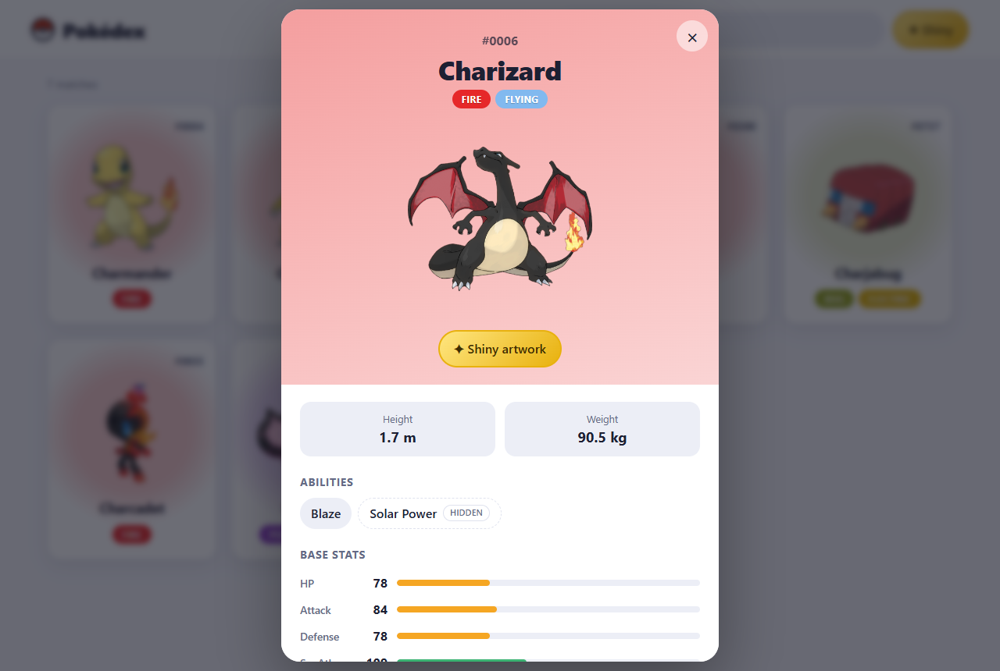

# Pokédex

A responsive Pokédex built with React, TypeScript and Vite. It uses data from the public [PokéAPI](https://pokeapi.co/).

Built from this prompt using Claude Opus 5.5:
```
Build a modern, responsive Pokédex application using React and TypeScript.

Use the public PokéAPI to display Pokémon in a card grid, with their artwork, names, numbers and types.

Users should be able to browse pages of 12 Pokémon, search by name or Pokédex number, open a Pokémon to view its stats and abilities, and toggle between normal and shiny artwork.

Include appropriate loading and error states. The application should run locally using Vite.
```

## Features

- Card grid that shows official artwork, name, National Pokédex number and types, 12 Pokémon per page.
- Search by name (partial matches, such as `saur`) or by Pokédex number (`25` or `#25`).
- Detail dialog with height, weight, abilities (including hidden abilities) and base stats.
- Shiny toggle that switches the artwork in the grid and in the detail dialog.
- Skeleton loading states, empty search results, and error messages with a retry button.
- The search query and page number are saved in the URL, so a refresh keeps your place.

## Screenshots

Each page shows 12 Pokémon with their artwork, Pokédex number, name and types.


Search matches partial names, and the Shiny toggle switches all artwork to the shiny variants.


Selecting a Pokémon opens a dialog with its abilities and base stats. The dialog has its own artwork toggle.



On narrow screens, the grid uses two columns and the search box and Shiny toggle move below the title. This screenshot uses dark mode.


## Run locally

Requires Node.js 20.19 or later.

```sh
npm install
npm run dev
```

Then open http://localhost:5173.

## Scripts

| Command           | Description                             |
| ----------------- | --------------------------------------- |
| `npm run dev`     | Start the Vite dev server.              |
| `npm run build`   | Type-check and build to `dist/`.        |
| `npm run preview` | Serve the production build locally.     |
| `npm run lint`    | Run ESLint.                             |

## How it works

On startup, the app loads the full species list from `/pokemon-species` once. Species IDs are National Pokédex numbers. Search and pagination filter this list locally. The app then requests `/pokemon/{id}` only for the 12 Pokémon on the current page and caches each response in memory.

| File                                   | Purpose                                         |
| -------------------------------------- | ----------------------------------------------- |
| `src/api.ts`                           | PokéAPI requests, response mapping and caching. |
| `src/App.tsx`                          | Search, pagination, loading and error states.   |
| `src/components/PokemonCard.tsx`       | Grid card and loading skeleton.                 |
| `src/components/PokemonDetail.tsx`     | Detail dialog with stats and abilities.         |
| `src/components/Artwork.tsx`           | Normal or shiny artwork with load fallback.     |
