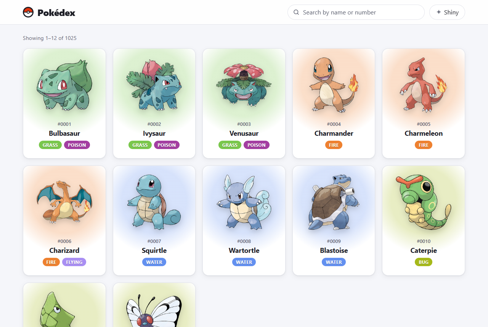
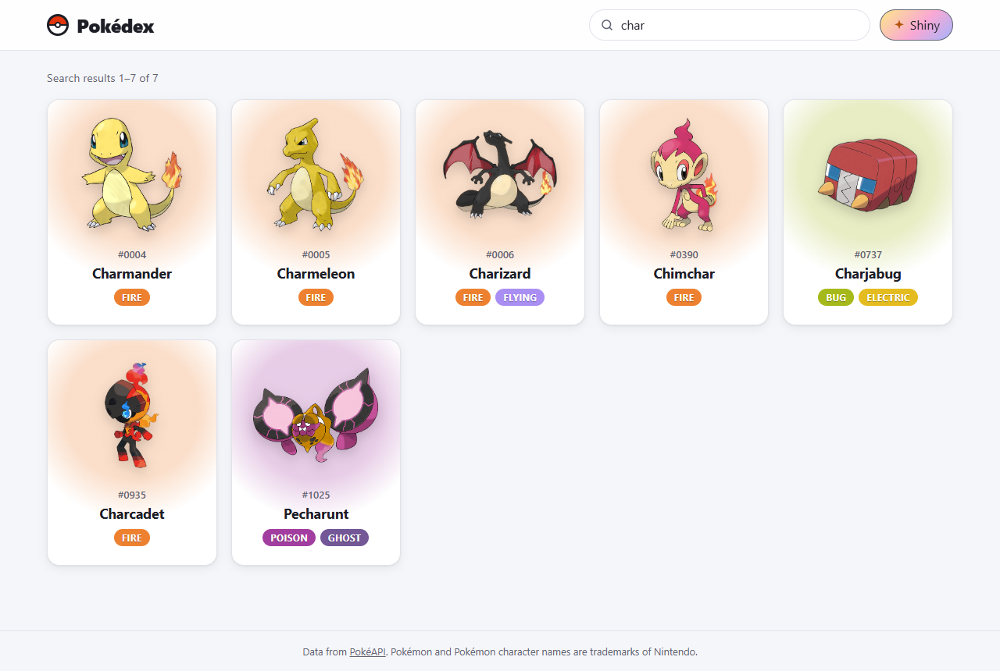
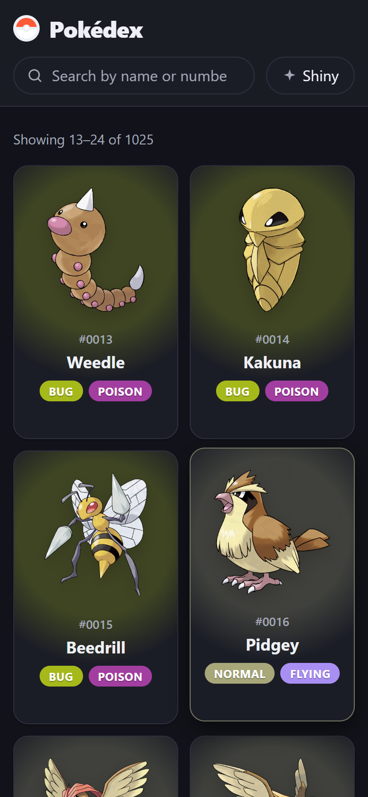

# Pokédex

A responsive Pokédex built with React, TypeScript, MobX and Vite. It uses data from the public [PokéAPI](https://pokeapi.co/).

Built from this prompt, following the `react-standards` skill, after a design interview with the `grilling` skill:
```
Build a modern, responsive Pokédex application using React and TypeScript.

Use the public PokéAPI to display Pokémon in a card grid, with their artwork, names, numbers and types.

Users should be able to browse pages of 12 Pokémon, search by name or Pokédex number, open a Pokémon to view its stats and abilities, and toggle between normal and shiny artwork.

Include appropriate loading and error states. The application should run locally using Vite.

Adhere to /react-standards. Now /grill-me !
```

## Features

- Card grid that shows official artwork, name, National Pokédex number and types, 12 Pokémon per page.
- Search by name (partial matches, such as `pika` or `mr mime`) or by Pokédex number (`25` or `#25`). Clearing a search returns you to the page you were browsing.
- Detail dialog with height, weight, abilities (including hidden abilities) and base stats.
- Shiny toggle that switches the artwork in the grid and in the detail dialog.
- Skeleton loading states, empty search results, a retry button if the Pokédex fails to load, and a retry button on any card that fails.
- Light and dark colours that follow the system setting.

## Screenshots

Each page shows 12 Pokémon with their artwork, Pokédex number, name and types.



Search matches partial names, and the Shiny toggle switches all artwork to the shiny variants.



Selecting a Pokémon opens a dialog with its stats and abilities.


On narrow screens, the grid uses two columns and the pagination controls shrink to Previous, the page count and Next. This screenshot uses dark mode.



## Run locally

Requires Node.js 20.19+ or 22.12+.

```sh
npm install
npm run dev
```

Then open http://localhost:5173.

## Scripts

| Command             | Description                         |
| ------------------- | ----------------------------------- |
| `npm run dev`       | Start the Vite dev server.          |
| `npm run build`     | Type-check and build to `dist/`.    |
| `npm run preview`   | Serve the production build locally. |
| `npm run lint`      | Run ESLint.                         |
| `npm run typecheck` | Type-check with `tsc -b`.           |
| `npm test`          | Run the Vitest suite once.          |

## How it works

On startup, the app loads the full species list from `/pokemon-species` once. Species IDs are National Pokédex numbers. Search and pagination filter this list locally. The app then requests `/pokemon/{id}` only for the 12 Pokémon on the current page and caches each response in memory. If you move to another page before the requests finish, the app cancels them and ignores any late results.

The MobX `PokedexViewModel` holds the app state. Components read it through a `ServiceProvider` exposed by React Context and never call PokéAPI directly.

| File                                          | Purpose                                                           |
| --------------------------------------------- | ----------------------------------------------------------------- |
| `src/services/PokeApiService.ts`              | PokéAPI requests, response validation and mapping, and caching.   |
| `src/services/pokemonNames.ts`                | Display names, search keys and Pokédex number formatting.         |
| `src/viewmodels/PokedexViewModel.ts`          | Search, pagination, shiny mode, selection and card loading state. |
| `src/app/ServiceProvider.ts`                  | Creates and registers the service and the ViewModel.              |
| `src/app/serviceContext.ts`                   | React Context and the `useService` hook.                          |
| `src/components/PokedexContent.tsx`           | Grid, empty results, and index loading and error states.          |
| `src/components/PokemonCard.tsx`              | Grid card with loading and error states, and skeleton cards.      |
| `src/components/PokemonDetailDialog.tsx`      | Detail dialog with stats and abilities.                           |
| `src/components/PokemonArtwork.tsx`           | Normal or shiny artwork with load fallbacks.                      |
| `src/components/SearchBox.tsx`                | Debounced search input.                                           |
| `src/components/Pagination.tsx`               | Page controls.                                                    |
| `src/test/fakes.ts`                           | Controllable fake `PokemonService` used by the tests.             |
